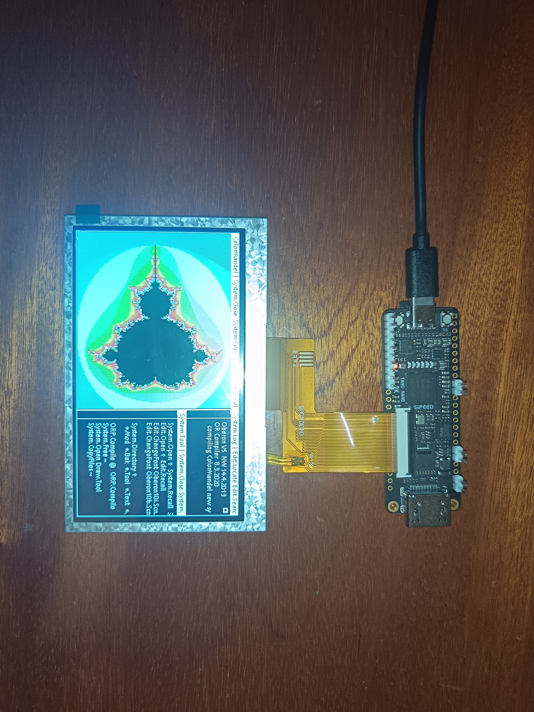

# Project Oberon in colour on the Tang Nano 9K

Niklaus Wirth's Project Oberon 2013 (the RISC5 CPU, the Oberon system and its compiler) on a Sipeed Tang Nano 9K
FPGA board with the Sipeed 4.3" 480 x 272 LCD. Oberon's black-and-white screen is shown on the LCD, and a colour
plane lies over it: 240 x 136 pixels of 4 bits with a palette of 16 RGB565 colours. `ColorMandel` draws the
Mandelbrot set in colour, compiled on the board by Oberon's own compiler.



 Stars on the board (Stars.Open, Stars.Run):

https://github.com/user-attachments/assets/bd282070-c06d-4770-8375-9ca1aa237943


| | |
|---|---|
| FPGA | Gowin GW1NR-9C (Tang Nano 9K): logic 4732 / 8640, block RAM 23 / 26 |
| CPU | Wirth's RISC5 with floating point, 16.875 MHz (timing met: Fmax 18.5 MHz) |
| Memory | 4 MB PSRAM (in the FPGA package) behind an 8 KB cache |
| Screen | 480 x 272 x 1 bit (Oberon's Display) + 240 x 136 x 4 bit colour plane, 16-entry RGB565 palette |
| Disk | Oberon's file system on a microSD card (SPI mode), from card block 80002H (256 MB) |
| Console | Oberon's command line on the serial line (USB), prompt `OR>` |

Tested on the board on 2026-11-17 with the files in `prebuilt/` (build, card write read back, ColorMandel drawn).

## Hardware

- Sipeed Tang Nano 9K
- Sipeed 4.3" RGB LCD, 480 x 272 (40-pin FPC), plugged into the board's LCD connector
- a microSD card, 4-32 GB (SDHC). Some cards, often very large or fake ones, accept writes in SPI mode but do not
  keep them; the card writer reads every block back and stops at the first difference. Use another card then.
- a USB-C cable to a Linux PC

## Tools to install

| tool | for | how |
|---|---|---|
| Python 3 + pyserial | assembler, disk tool, card writer | `sudo apt install python3 python3-serial` |
| Gowin EDA (Education edition is enough for the GW1NR-9C) | building the bitstream (`gw_sh`) and programming (`programmer_cli`) | from gowinsemi.com; this project expects it at `/tools/Gowin` (`IDE/` and `Programmer/`); another place: `export GOWIN_HOME=/path/to/IDE` |
| or openFPGALoader | programming only | `sudo apt install openfpgaloader` |
| a serial terminal | Oberon's command line | `sudo apt install putty` (or `picocom`) |
| Icarus Verilog | the simulations (optional) | `sudo apt install iverilog` |

Tested with Python 3.12, pyserial 3.5, Icarus Verilog 12.0 and Gowin EDA V1.9.11.03 Education on Ubuntu 24.04.5 LTS.

USB access: your user must be in the `dialout` group (`sudo usermod -aG dialout $USER`, then log in again).

## Folders

```
rtl/            the design: r5_board.v (top, PLLs), r5_tang.v (CPU + memory map + I/O), RISC5F.v (Wirth's CPU,
                RAM read at the rising edge), r5_cache.v + r5_psram.v (PSRAM), r5_lcd.v (LCD, colour plane,
                palette), r5_prom.v (boot ROM), RS232R.v / RS232T.v (serial line)
rtl/wirth/      Wirth's unchanged Verilog (multiplier, divider, floating point, SPI; RISC5.v for reference) and
                its license
programs/       RISC5 assembly: monitor.s (the boot ROM, prompt r5>) and test programs for the simulation
oberon/         Oberon modules: ColorMandel.Mod, Mandel.Mod, Hello.Mod, TTY.Mod (the serial command line)
gowin/          the Gowin project: build.tcl, gw_build.sh, pins (r5.cst), clocks (r5.sdc)
tb/             testbenches and models (HyperRAM, SD card in SPI mode)
tools/          r5asm.py (assembler), dskadd.py (add files to an Oberon disk), sdwrite.py (card writer),
                r5load.py, mkcore.py, odsk.py
prebuilt/       the tested files: r5_tang.fs (bitstream), prom.mem (boot ROM), Oberon.dsk (Oberon's disk),
                OberonC.dsk (the same + ColorMandel.Mod), SHA256SUMS
```

## Quick start (prebuilt files)

Run each command in the repository folder after the previous one has finished. Only one program may use the
serial port at a time: close the terminal before steps 3 and 4.

1. Check the files:
   ```
   sha256sum -c prebuilt/SHA256SUMS
   ```
2. Release the board's JTAG channel. Linux's serial driver takes both channels of the board's USB chip after
   every plug-in; Gowin's programmer needs the first one. Find its name (it ends in `:1.0`, e.g. `3-2:1.0`):
   ```
   ls /sys/bus/usb/drivers/ftdi_sio/
   ```
   ```
   echo -n 3-2:1.0 | sudo tee /sys/bus/usb/drivers/ftdi_sio/unbind
   ```
   (openFPGALoader does this by itself: skip this step if you use it.)
3. Load the bitstream into the FPGA (it is lost at power-off: repeat this step after every power-up):
   ```
   /tools/Gowin/Programmer/bin/programmer_cli --device GW1NR-9C --run 2 --frequency 1MHz --fsFile "$PWD/prebuilt/r5_tang.fs"
   ```
   or `openFPGALoader -b tangnano9k prebuilt/r5_tang.fs`. Expected: `Finished.` Then press the reset button S1.
4. Write Oberon to the SD card (about 3.5 minutes, once per card). The board writes the disk from card block
   80002H and reads every block back. The card's own partitions and files are ignored, but whatever lies at
   256..257 MB of the card is overwritten.
   ```
   python3 tools/sdwrite.py --port /dev/ttyUSB1 prebuilt/OberonC.dsk
   ```
   Expected: `1976/1976 blocks`, `sdwrite: blocks 80002..807B9 written and read back`.
   `no r5> prompt`: press S1 and run it again. `--port`: the board's second serial port; `ls /dev/serial/by-id/`
   shows it as `...if01-port0`.
5. Open the terminal (115200 baud, 8N1):
   ```
   putty -serial /dev/ttyUSB1 -sercfg 115200,8,n,1,N -fn "client:DejaVu Sans Mono 12"
   ```
   Press Enter: the boot monitor answers `r5> `. Type `o` (boot Oberon from the card):
   ```
   Oberon V5  NW 14.4.2013
   OR>
   ```
   The LCD shows Oberon's screen.
6. The coloured fractal. At `OR>`:
   ```
   ORP.Compile ColorMandel.Mod/s
   ```
   ```
   ColorMandel.Draw
   ```
   Oberon's compiler runs on the FPGA and saves ColorMandel.rsc on the card; the set appears in colour in the left
   track. After a power cycle (steps 2, 3, 5) `ColorMandel.Draw` works without compiling again.

More at `OR>`: `Mandel.Draw` (black and white, after `ORP.Compile Mandel.Mod/s`), `Hilbert.Draw`, `Sierpinski.Draw`,
`Stars.Open` then `Stars.Run` (`Stars.Stop`), `System.Directory *.Mod`, `System.Close` (closes the lowest viewer of
the left track; there is no mouse). At `r5>`: `?` lists the monitor's commands.

## Build from the sources

The steps produce the same files as `prebuilt/` (the bitstream differs only in Gowin's time stamp).

1. **Assemble the boot ROM** (the monitor, prompt `r5>`) into `build/prom.mem`:
   ```
   mkdir -p build
   ```
   ```
   python3 tools/r5asm.py programs/monitor.s -o build/prom.mem --words 1024
   ```
   Expected: `(959 of 1024 words)`; the file equals `prebuilt/prom.mem`.
2. **Simulate** (optional, needs Icarus Verilog and Gowin's simulation library `IDE/simlib/gw1n/prim_sim.v`):
   ```
   ./run_lcd.sh
   ```
   Expected: `LCD TB: 2/2 PASS` (the LCD alone: frame memory, colour plane, palette; seconds).
   ```
   ./run_rf.sh
   ```
   Expected: `RESULT: 51/51`, `TB PASS`, `O3 PSRAM TB: 6/6 PASS` (the whole board with a terminal, PSRAM and SD
   card models: monitor commands, programs loaded over the serial line, PSRAM, cache, SD read and write, LCD;
   about 40 minutes). It also assembles `build/prom.mem` (step 1).
3. **Build the bitstream** (Gowin synthesis and place and route, no GUI, about 2 minutes):
   ```
   cd gowin && ./gw_build.sh; cd ..
   ```
   Result: `gowin/impl/pnr/r5_tang.fs`. Check: no `ERROR` lines; `gowin/impl/pnr/r5_tang.rpt.txt` BSRAM 23/26;
   `gowin/impl/pnr/r5_tang_tr_content.html` "Max Frequency Summary": clk_cpu at least 16.875 MHz, clk27 at least
   27, mclk at least 54, and "Total Negative Slack" 0 on all clocks.
4. **Make the colour disk**: Oberon's disk + ColorMandel.Mod as a text file (no Oberon tools needed):
   ```
   mkdir -p build/oberon
   ```
   ```
   python3 tools/dskadd.py prebuilt/Oberon.dsk build/oberon/OberonC.dsk oberon/ColorMandel.Mod
   ```
   Expected: `139 files (1 added) ... directory checked`. `dskadd.py IMAGE OUT FILE...` adds any module the same
   way (a file of the same name is replaced).
5. **Load and run**: Quick start steps 2-6 with `"$PWD/gowin/impl/pnr/r5_tang.fs"` and `build/oberon/OberonC.dsk`.

## How it works

| address | what |
|---|---|
| 000000H-3FFFFFH | 4 MB PSRAM through an 8 KB cache: Oberon's memory |
| 400000H-403FBFH | the 1-bit frame memory, 480 x 272 (Oberon's Display module draws here) |
| 404000H-407FFFH | the colour plane: 240 x 136 pixels of 4 bits, each covering 2 x 2 LCD pixels |
| 408000H-40803FH | the palette: 16 RGB565 colours (write only) |
| 0E7F00H | the monitor writes 53697A67H, 480, 272, 400000H here before Oberon starts: Display reads the size |
| FFE000H | the boot ROM with the monitor (`programs/monitor.s`) |
| FFFFC0H | I/O: timer, LEDs, serial line, SPI (SD card) |

An LCD pixel shows the palette colour of its colour-plane value, or Oberon's black or white where the value is 0
(transparent). So Oberon's text and menus stay as they are, and a program like ColorMandel paints colour under them.
The CPU runs at 16.875 MHz (PLL from the 27 MHz crystal), the LCD at 9 MHz per pixel (27 MHz / 3), and the PSRAM
controller at 54 MHz. `o` at `r5>` loads Oberon's inner core from the card (Wirth's BootLoad) and starts it.

Comments in the code name the stage that added each part: S (Wirth's RISC5 ported to the Tang), F (faster CPU,
16.875 MHz), O (PSRAM, cache, SD card, boot from the card), L (the LCD; L4 the colour plane).

## Licenses and credits

- Project Oberon 2013 (RISC5 Verilog in `rtl/wirth/`, the Oberon system in the disk images): Niklaus Wirth, Juerg
  Gutknecht, Paul Reed; see `rtl/wirth/license.txt`. `RISC5F.v`, `RS232R.v`, `RS232T.v` and `r5_prom.v` are
  changed copies of Wirth's files under the same license.
- The disk image was built with Peter De Wachter's project-norebo; the fonts come from his oberon-risc-emu disk.
- LCD timing and pins after Sipeed's TangNano-9K-example (lcd_4.3).
